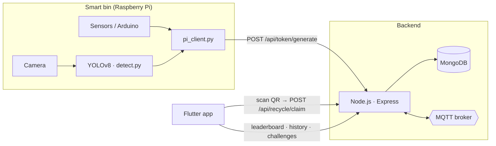

<div align="center">

# ♻️ WasteMaster

**A gamified, IoT‑enabled smart recycling system: a bin that recognises waste, a backend that rewards it, and a mobile app that makes recycling a game.**


</div>

---

## ✨ What it does

1. **Detect.** A camera on the bin classifies each item (cardboard, glass, metal, paper, plastic, trash) with a YOLOv8 model and routes it to the right compartment.
2. **Reward.** The bin asks the backend for a one‑time **reward token**. The server answers with a token and a **QR code**, shown on the bin's screen.
3. **Claim.** The user scans the QR code in the Flutter app and instantly receives points. A token can only be claimed once.
4. **Play.** Points feed a **leaderboard**, personal **history**, and community **challenges** to keep people recycling.



## 🧰 Tech stack

| Layer | Technology |
|---|---|
| Mobile app | Flutter / Dart (login, home, QR scan, history, leaderboard, challenges, profile) |
| Backend | Node.js, Express, Mongoose, MQTT, dotenv |
| Database | MongoDB (local or Atlas) |
| Computer vision | YOLOv8 (Ultralytics), trained on a TrashNet‑style Roboflow dataset (`Final Grad/`) |
| Hardware | Raspberry Pi (GPIO, camera), Arduino sensor sketch |

## 📂 Repository layout

```
Backend/          Express API, models, MQTT bridge, Pi/Arduino clients, verification scripts
mobile app/       Flutter application
Final Grad/       Object-detection notebook, dataset config and YOLOv8 weights
*.md              Integration, power-wiring and requirements notes
```

## 🚀 Quick start

### Prerequisites
[Node.js 18+](https://nodejs.org/) · [MongoDB](https://www.mongodb.com/try/download/community) (local on `27017`, or an Atlas cluster) · [Flutter SDK](https://docs.flutter.dev/get-started/install) · Android Studio or VS Code.

### 1 · Backend

```bash
cd Backend
npm install
cp .env.example .env        # then edit the values (see table below)
node seed_challenges.js     # first run only: creates the challenges
npm run dev                 # → "Server running on port 5000" + "MongoDB Connected"
```

**Configuration** (`Backend/.env`, never committed):

| Variable | Example | Purpose |
|---|---|---|
| `PORT` | `5000` | HTTP port |
| `MONGODB_URI` | `mongodb://127.0.0.1:27017/wastemaster` | MongoDB connection string |
| `MQTT_BROKER_URL` | `mqtt://test.mosquitto.org` | MQTT broker for the IoT bridge |

> ⚠️ Keep real credentials out of git. `.env` is ignored; only `.env.example` is tracked. If you use MongoDB Atlas, create a dedicated database user for the project and restrict its network access.

### 2 · Mobile app

```bash
cd "mobile app"
flutter pub get
```

Open `lib/services/api_service.dart` and set `baseUrl` to your machine's LAN address (`ipconfig` / `ifconfig`), for example `http://192.168.1.5:5000/api`. On an Android emulator running on the same PC use `10.0.2.2`.

```bash
flutter run
```

### 3 · IoT bridge (Raspberry Pi)

`Backend/pi_client.py` turns a "waste sorted" event into a reward token.

- **Simulation mode (default):** run it anywhere and press <kbd>Enter</kbd> to simulate an item.
- **Hardware mode:** set `REAL_HARDWARE = True`; it listens on GPIO pin 17 (for example an inductive proximity sensor) and calls the API automatically.

```bash
pip install requests
python pi_client.py
```

Custom hardware (Arduino, ESP32…) only needs one request:

```http
POST /api/token/generate
Content-Type: application/json

{ "wasteType": "plastic" }
```

```json
{ "success": true, "token": "b3deedaf…", "points": 10, "qrUrl": "https://api.qrserver.com/…" }
```

### 4 · Waste detection

`Backend/detect.py` runs the YOLOv8 classifier on a camera stream and maps each class to a bin (`PAPER`, `PLASTIC`, `METAL`, `GLASS`, `TRASH`). Training and evaluation live in `Final Grad/ODmodel.ipynb`; the dataset configuration is `Final Grad/data.yaml` (6 classes, [TrashNet on Roboflow](https://universe.roboflow.com/polygence-project/trashnet-a-set-of-annotated-images-of-trash-that-can-be-used-for-object-detection), CC BY 4.0).

## 🔌 API overview

| Method | Endpoint | Description |
|---|---|---|
| `POST` | `/api/token/generate` | Bin requests a reward token + QR code |
| `POST` | `/api/auth/register` · `/api/auth/login` | Account creation and login |
| `GET` | `/api/user/:id` | Profile and points |
| `POST` | `/api/recycle/claim` | Claim a token (single use) |
| `GET` | `/api/leaderboard` | Top recyclers |
| `GET` | `/api/history/:userId` | A user's recycling history |
| `GET` · `POST` | `/api/challenges` · `/api/challenges/join` | List and join challenges |

## ✅ Verify the whole chain

`verify_iot_bridge.js` plays both the bin and the app: generates a token, registers/logs in a user, claims the token, and checks that claiming it twice is rejected.

```bash
cd Backend
node verify_iot_bridge.js          # against your local server
node verify_iot_bridge.js --prod   # against the deployed server
```

## 🧯 Troubleshooting

| Symptom | Fix |
|---|---|
| App shows "Connection refused" | Use your PC's LAN IP, not `localhost`, in `api_service.dart` |
| `MongoDB Connection Error` | Start the MongoDB service, or check `MONGODB_URI` |
| Flutter "Disk full" | `flutter clean`, then free some space |

## 📚 More documentation

[`FULL_Cycle_Integration.md`](FULL_Cycle_Integration.md) · [`Power_Connection.md`](Power_Connection.md) · [`REQUIREMENTS.md`](REQUIREMENTS.md) · [`backend commands.md`](backend%20commands.md)

## 👥 Team

Built as a graduation project by [Mohab Islam](https://github.com/mohab-islam) and [Osama Khalid](https://github.com/Osama1khalid).
